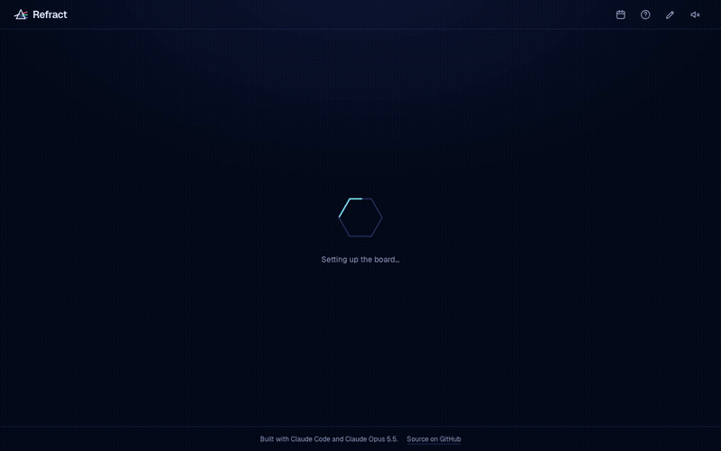
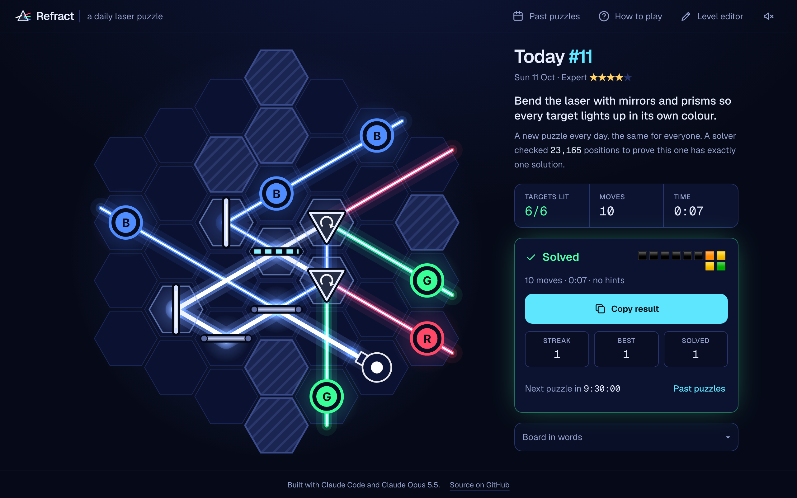
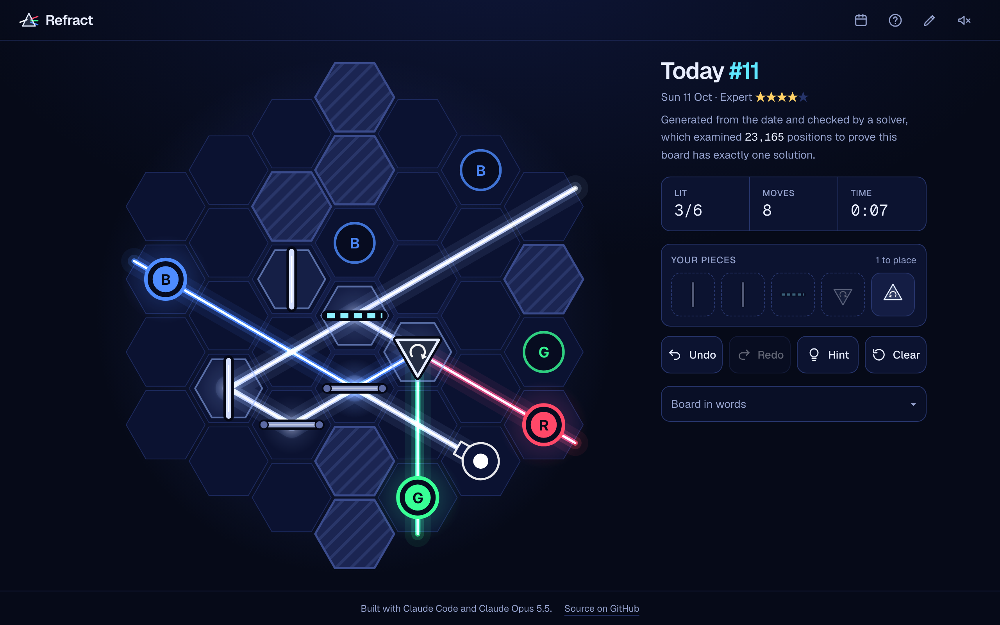
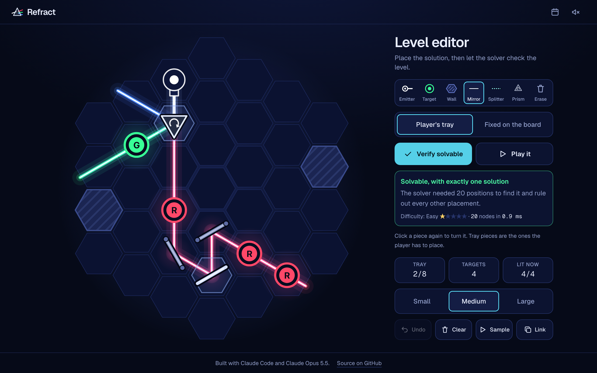
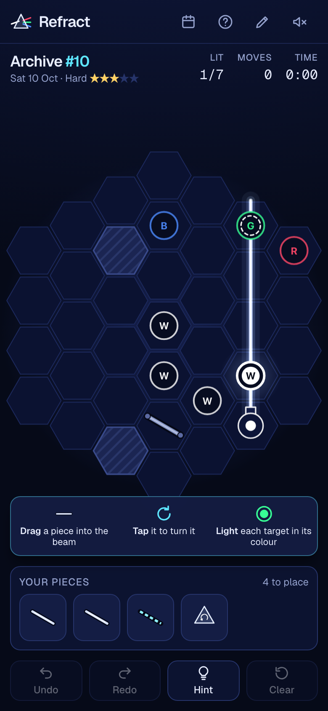
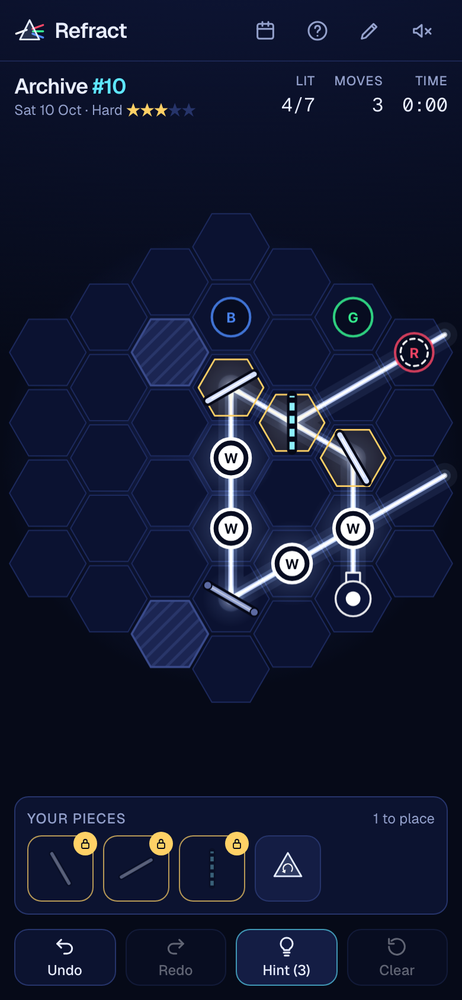
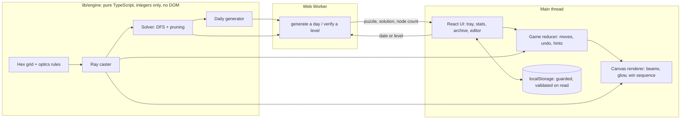

# Refract

**A daily light-bending puzzle: the same board for everyone each day, and a solver proves every one has exactly one solution before you play it.**

[](https://github.com/davezagin-max/refract/actions/workflows/ci.yml)
[](LICENSE)
[](#run-locally)



*One full game, from the first screen to the win: drag a piece (mirror, splitter or prism) from the tray onto the board, tap it to turn it, and steer the laser until every target glows in its own colour.*

## What it does

- **A new puzzle every day, identical for everyone.** The board is built from the date, right in your browser: no server and no account.
- **Every puzzle is proven fair.** Before you see it, a solver tries the ways the pieces could go and confirms there is exactly one answer. How hard it had to work becomes the difficulty rating (Easy to Expert).
- **Real light, real game feel.** Mirrors bounce the beam, splitters copy it, prisms break white light into red, green and blue, and colours mix where beams meet. The glowing beams are animated on a canvas designed to hold 60 frames per second, phones included.
- **A level editor too.** Build your own puzzle, and the same solver tells you whether it can be solved, whether the answer is unique, and how hard it is.

## Try it

The live demo is coming soon. Until then it runs locally in about a minute, with no key and no sign-up (needs Node 20.9+ and pnpm):

```bash
pnpm install
pnpm dev     # then open http://localhost:3160
```

The GIF above is a full game. Drag a piece from the tray into the beam and tap it to turn it; light every target in exactly its colour (the letter in each target names the colour). Stuck? **Hint** places one piece where it belongs.

Everything runs in your browser. There is no server, no AI model and no recorded data: today's board is generated on your device from today's UTC date, so everyone gets the same puzzle.



*A solved Sunday (expert) puzzle. Two prisms split the white laser into red, green and blue; the side column states the goal, the solver's proof, and the result you can share.*

<p align="center">
  
  
</p>
<p align="center">
  
  &nbsp;&nbsp;
  
</p>

*Above: mid-game on a desktop; the level editor, where the solver proves a level and rates it; and the game at 390px wide, on first load and in play.*

When you finish, **Copy result** puts a spoiler-free summary on the clipboard. This is the one for the game in the solved screenshot: one square per move, coloured by how many targets were lit after it, and nothing about where the pieces go. The copied text ends with a link to the puzzle.

```text
Refract #11 · Expert ★★★★☆
10 moves · 0:07 · no hints
⬛⬛⬛⬛⬛⬛🟧🟨
🟨🟩
```

## Why it's interesting

- **The optics are exact integer math, not floating-point geometry.** Beams travel in six directions and a mirror sits at one of six angles, so reflecting across a mirror reduces to `d' = (m − d) mod 6`. A test checks that rule against real Euclidean reflection for all 36 mirror and beam combinations. Light is a 3-bit mask of red, green and blue, so mixing is a bitwise OR and a target needs an exact match (extra light makes it wrong, which is half the puzzle). The ray caster ends on mirror loops because each (cell, direction, colour channel) can be entered only once.
- **A solver proves each puzzle has one solution, and its effort is the difficulty rating.** It is a depth-first search that always branches on the unmet need (a target missing a colour, or receiving one it must not) with the fewest cells that could fix it, with four pruning rules and a scheme that visits every set of placements exactly once without a visited-state table. On the expert board for Sunday 11 October 2026 it examines 23,165 positions where the unpruned search examines 4,610,347. The generator works backwards from a solved board, then asks the solver for unintended solutions and adds the target or wall that kills the most of them, until one solution is left. The "positions checked" number shown under each puzzle's goal is that proof's size.
- **Game feel on a canvas built to hold 60fps.** Beams are layered additive strokes (never `shadowBlur`), batched into one path per colour, so a frame costs about five strokes per colour however many segments are on screen. When you move a piece only the changed part of the light animates, growing outward from the point of change in the order light would travel. The renderer times its own frames and lowers the canvas pixel density if a device cannot keep up.

### What the pruning buys

Positions examined to find the solution and prove there is no other, on four of the first days (one per difficulty tier). "Naive" is the same solver with pruning switched off (`strategy: "naive"`), which a test uses as a cross-check: both must return the same solutions.

| Day | Tier | Tray pieces | With pruning | Naive | Fewer positions |
| --- | --- | --- | --- | --- | --- |
| Mon 5 Oct 2026 | Easy | 2 | 20 | 333 | 17x |
| Wed 7 Oct 2026 | Medium | 3 | 458 | 38,623 | 84x |
| Fri 9 Oct 2026 | Hard | 4 | 3,198 | 330,725 | 103x |
| Sun 11 Oct 2026 | Expert | 5 | 23,165 | 4,610,347 | 199x |

Node counts are deterministic. Over the seven days from 5 to 11 October the gain ranges from 7x to 199x and grows with the number of pieces. In wall-clock terms the expert board takes about 20 ms with pruning and about 1 s without, in Node on an Apple M5 Pro.

### How a day's puzzle is made

1. **Seed.** `refract/v1/2026-10-11#0` is hashed (FNV-1a) into a mulberry32 generator. Integer-only, so every JavaScript engine produces the same sequence.
2. **Build a solved board.** Put an emitter on the rim, then add pieces one at a time on cells the light already reaches, each turned so it changes the beam and cuts off no earlier piece.
3. **Choose targets.** A greedy cover picks lit cells so that every tray piece matters to at least one target.
4. **Remove unintended solutions.** Run the solver. For each solution other than the intended one, find the cell where a new target or wall would rule it out; add the one that kills the most; repeat.
5. **Accept or retry.** Keep the puzzle only if the final exhaustive search finds exactly one solution and its node count falls inside the day's band (Easy under 150, Medium under 1,500, Hard under 8,000, Expert under 30,000). Otherwise try the next sub-seed, `#1`, `#2`, and so on.

Tiers follow the week like a crossword: Monday and Tuesday easy, Sunday expert. Budgets are node counts, never time limits, so a slow phone and a fast laptop always arrive at the same board. Over the first 1,830 days (five years) every day lands in its band; 896 are accepted on the first sub-seed and the worst needs 59 tries. A precomputed table of "which sub-seed wins" (one character per day, checked by the generator before it is trusted) turns that worst day from about 1.2 s of generation into about 50 ms.

## Architecture



- `lib/engine/` knows nothing about React or the browser. The same `trace` function is used by the solver, the game rules and the renderer, so what you see is what the solver proved.
- `lib/game/` holds the rules as a pure reducer (`reduce(state, action)`), plus share text, streaks, storage and the worker client.
- `lib/render/` is the Canvas 2D renderer and the animation planning.
- The generator and solver run in a Web Worker and are not in the page's JavaScript at all (a chunk of about 21 KB before compression that only the worker loads). If a worker cannot start, the same code is imported lazily and runs on the main thread.
- Every route (`/`, `/editor`, the not-found page) is prerendered as a static file. There are no API routes.

## Built with

Claude Code and Claude Opus 5.5 built this project. The game itself runs no model: no API calls, no key, nothing to configure.

| Part | Choice | Why |
| --- | --- | --- |
| App | Next.js 16 (App Router), React 19, TypeScript strict | Static prerendering, typed end to end |
| Board | Canvas 2D with `requestAnimationFrame` | Additive glow and per-frame animation with no rendering library to download |
| Heavy work | Web Worker | Generation and solving never block a frame; a long "verify" can be stopped by replacing the worker |
| State | A pure reducer plus guarded `localStorage` | Every rule is unit tested without a DOM; a storage failure never stops play |
| Sound | WebAudio oscillators, off by default | No audio files to download |
| Styling | Tailwind 4 with design tokens | One deep-navy theme; the canvas shares the same palette |

## Run locally

```bash
pnpm install
pnpm dev
```

Open http://localhost:3160. Useful extras: `/editor` for the level editor, and `/?day=2026-10-07` for any past day.

## Tests & quality

```bash
pnpm check   # lint, typecheck, unit tests, production build
pnpm e2e     # after a build: plays the real app in headless Chromium
```

129 unit tests (Vitest) cover the parts the spec names and the parts most likely to be wrong:

- **Reflection math**: the mirror rule against Euclidean reflection for all 36 combinations, the splitter, the prism, and the lookup tables against the rule functions.
- **Ray casting**: turns, walls, splitting, dispersion, colour mixing, mirror loops, and a termination bound on random boards.
- **Solver correctness**: agreement with an exhaustive brute-force reference on 250 random small puzzles (sound, complete, no placement visited twice), agreement with the naive strategy, and a puzzle whose only solution sends the beam through the same piece twice.
- **Generator determinism**: the same date always gives the same puzzle; 70 consecutive days are valid, uniquely solvable, in their difficulty band, and match the precomputed table.
- **Game rules**: the reducer (moves, undo and redo, hints, win), share text, streaks, save and restore, the keyboard cursor, the text description, the editor model, the worker client (including stopping a solve), and the frame-rate fallback.

`pnpm e2e` is a Playwright script with 120 checks against the production build: it plays puzzles to a win by mouse, by touch and by keyboard alone, at 1280, 390 and 360 pixels wide; checks the first screen (the goal is visible, the how-to never covers the board, the tray is marked as the place to start); reloads mid-game; opens every dialog; uses the editor; runs with storage blocked and with no Web Worker; and fails on any console error or sideways page scroll.

CI runs lint, typecheck, unit tests and the build, plus a gitleaks secret scan, on every push. The browser script is run locally, not in CI.

Accessibility: full keyboard play (a cursor on the board, pick up, turn, place, undo), a live region that announces each move, a "Board in words" description of the whole board, colour letters on every target so colour is never the only cue, 44px touch targets, and `prefers-reduced-motion` honoured in the canvas and the page.

## Tradeoffs, limitations, next steps

- **Not tested on a physical phone, in Safari or Firefox, or with a screen reader.** Everything above was verified in headless Chromium, including touch emulation. Frame rate: a steady 60fps at phone size and 3x pixel density, also with the CPU throttled 4x; at 6x throttle it dips to about 50fps with every beam lit, the fallback drops the density to 2x, and it returns to 60. That is evidence, not a measurement on a real device.
- **Difficulty is the solver's effort, not a human's.** Node count tracks how much there is to rule out, which is a reasonable proxy, but it has not been calibrated against real solve times. That is the first thing I would measure with players.
- **"Exactly one solution" is exact for daily puzzles.** The solver reports minimal solutions (every placed piece matters), and the generator only accepts a puzzle whose one solution uses the whole tray. In the editor a level can have one solution that leaves pieces over; the editor says so instead of calling it unique.
- **Streaks live in one browser.** There are no accounts, and "today" comes from the device clock (in UTC), so a streak is a personal record, not a leaderboard entry.
- **A drag that starts on the board does not scroll the page** on a phone, because the board captures touch for moving pieces. Everything needed to play is on the first screen; the text description sits below it.
- **The precomputed table covers five years** (to 4 October 2031). After that, or if the generator changes and the table is not rebuilt with `pnpm hints`, the slowest days take about a second to generate on a laptop and longer on a phone. It happens in the worker behind a loading state, once per day per device.
- **One theme.** Deep navy only; there is no light mode.
- Smaller things: the per-day puzzle cache in `localStorage` is never pruned, `docs/demo.gif` is about 2.7 MB, and `components/Game.tsx` (pointer, keyboard and layout in one component) is the file I would split next.

Next steps: calibrate difficulty against real play, run the browser checks in CI, an installable offline build, and new pieces (colour filters, one-way gates), each of which is one entry in the optics table plus tests.

---

Built with Claude Code and Claude Opus 5.5.
